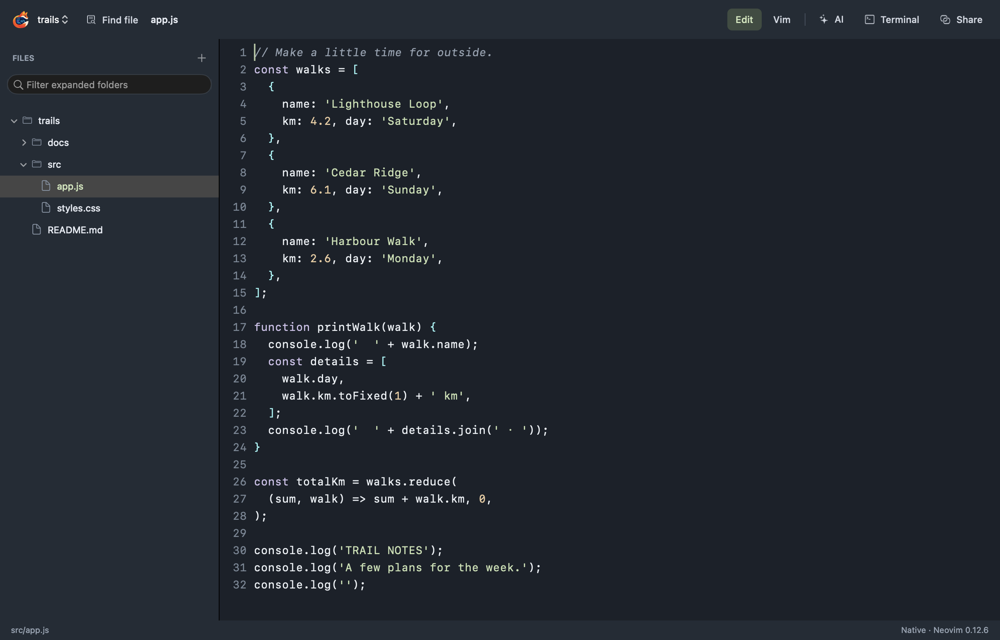
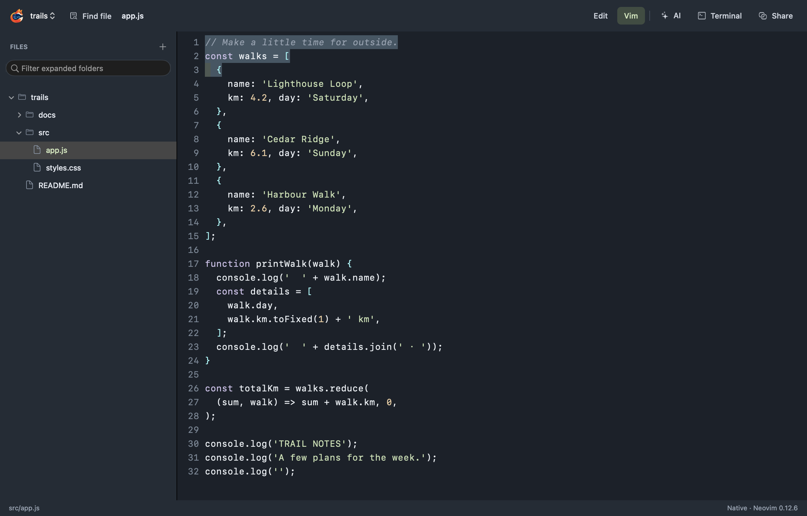
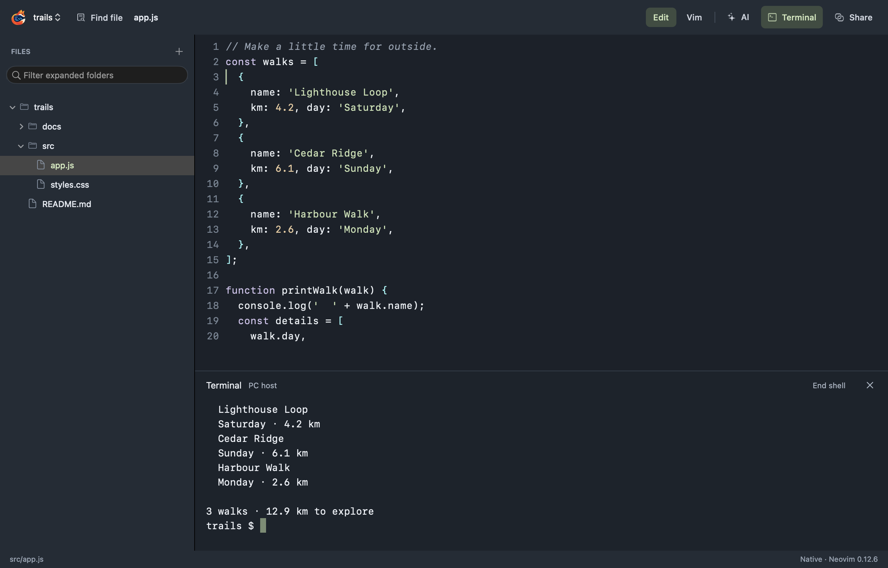
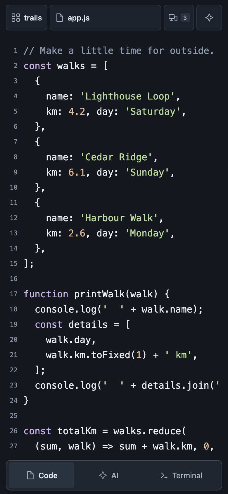

# Nimlo


**A native Mac editor powered by Neovim.**

Nimlo brings a native file tree, fast file search, a real Neovim editor, persistent project terminals, and your installed AI tools into one workspace. Pair your phone to keep working with the same files and host session.

[Download Nimlo](https://github.com/guilhermegm/Nimlo/releases/latest) · [Quick start](#quick-start) · [Screenshots](#screenshots) · [Security](SECURITY.md)

## Quick start

The current native release supports **Apple silicon Macs running macOS 13.3 or later**. Neovim 0.12.6 and its runtime are included; a separate Neovim installation is not needed.

1. Download `Nimlo-0.3.0-macos-arm64.zip` from [GitHub Releases](https://github.com/guilhermegm/Nimlo/releases/latest) and extract it.
2. Drag **Nimlo.app** into **Applications** and open it.
3. Choose **Open folder…** and select your project.
4. Choose a file in the native sidebar, or press **⌘P** to find one.

The app is ad-hoc signed and not Apple-notarized. If macOS blocks the first launch, see [Apple's instructions for opening an app you trust](https://support.apple.com/en-us/102445). Updates are installed manually by quitting Nimlo and replacing its app bundle.

### Edit or use Vim

**Edit** is the default: type normally, select with Shift+Arrow, and use standard Mac copy, cut, and paste shortcuts. Choose **Vim** in the toolbar for Neovim's modal navigation, visual selections, commands, and macros.

| Shortcut | Action |
| --- | --- |
| **⌘P** | Find a project file; Tab completes a folder or path |
| **⌘F** | Find text in the current file |
| **⌘G / ⌘⇧G** | Next / previous match |
| **⌘S** | Save the current file |
| **⌘Z / ⌘⇧Z** | Shared undo / redo |
| **⌘W** | Close the current file, with unsaved-change protection |

Nimlo runs an isolated Neovim configuration. Personal Neovim plugins and configuration are not loaded.

### Terminal and AI

Choose **Terminal** in the toolbar to open the project's persistent shell below the editor. Choose **AI** to open chat beside your code. Both stay in the same window, and closing a pane keeps its host process running.

To configure an installed, signed-in AI provider, choose **Workspace → AI Settings…**. Start with **Ask before changes** so proposed changes require your review. Save or discard changed files before sending a request. Provider authentication stays in the installed CLI on your Mac; Nimlo does not read provider credential files.

### Continue on your phone

1. Install the official [cloudflared connector](https://developers.cloudflare.com/tunnel/downloads/) on the Mac for internet pairing.
2. Choose **Share** in Nimlo's toolbar, then **Create internet link**.
3. Copy the complete invitation link to your phone and open it in the phone's browser.
4. Enter the six-digit code shown on the Mac, plus the pairing password if you set one.

Keep the Mac awake and Nimlo running. Invitations expire after two minutes and work once. The phone uses the browser editor while sharing acknowledged file changes and host tools with the native Neovim editor. Session permissions and the host trust boundary are explained in [SECURITY.md](SECURITY.md).

## Screenshots

Nimlo's native AppKit editor running the bundled Neovim 0.12.6 with a sample project.



<details>
<summary>Vim mode, terminal, and the paired phone</summary>

**Real Vim navigation and selections**



**Persistent host terminal in the same window**



**The paired phone browser**



</details>

## Build from source

Install Rust/Cargo, Apple's Command Line Tools, Python 3.12 or later, and curl. Then run:

```sh
make build
open target/desktop/Nimlo.app

# Open a particular project directly.
make run PROJECT="/absolute/path/to/project"

# Install in ~/Applications or package a ZIP.
make install
make package
```

The build downloads the pinned official Neovim archive and verifies its SHA-256 digest from `neovim-release.json`. The app bundles Neovim, the workspace host, and browser assets. Node and Playwright are development tools used by the integration checks.

## Validation

```sh
make test          # Workspace/service tests
make test-native   # Real AppKit editor, Neovim, paired browser and fake AI
make test-web      # Browser/workspace regression checks
make check         # Formatting, strict Clippy and script syntax
```

Set `PLAYWRIGHT_PATH` and `NIMLO_WS_MODULE` to installed development modules when needed. Integration checks use disposable projects and fake AI providers, with no paid inference requests. Reports are written under `target/neovim-review` and `tests/` and are excluded from publication.

The native editor, file tree, project switcher, file picker, and search use AppKit and Neovim without creating a WebView. AI, terminal, sharing, and permissions use one lazily created tools WebView in the same window. The workspace host owns shared document revisions, bounded undo/redo, durable recovery, device permissions, and provider sessions. Neovim's RPC stays private to the native app.

Workspace state is stored under `~/.nimlo-neovim`, including a private journal for native edits awaiting acknowledgment. Physical input methods, accessibility, unusual Unicode shaping, and long-running performance need further validation. The current native build targets Apple silicon; additional native platforms need their own implementation and validation.

## Neovim

Nimlo bundles the official pinned [Neovim](https://github.com/neovim/neovim) release. Its license is included in [licenses/Neovim-LICENSE.txt](licenses/Neovim-LICENSE.txt), and the runtime includes Vim's license and documentation in `doc/uganda.txt`.
