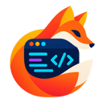

# Nimlo



**Small footprint. Full workspace.**

The colored launcher artwork lives in `assets/nimlo-icon.png`; the transparent welcome logo lives in `assets/nimlo-logo.png`. Run `make icons` to generate the macOS icon at standard sizes up to 1024 px, the 32 px browser favicon, the 180 px phone home-screen icon, and separate transparent welcome logos (256 px native, 128 px web). The originals stay in the source assets; the app bundles the resized versions directly, with no icon service or extra runtime process.

A working Rust host and custom code editor for projects shared between a PC and other devices. One authenticated session holds the attached project folders, unsaved buffers, recovery, persistent terminals, and on-demand Codex/Claude jobs. The client uses plain HTML, CSS, and JavaScript, without Monaco or CodeMirror. The first desktop app uses macOS AppKit and the system WKWebView rather than bundling Electron, Chromium or a Node runtime.

[Download Nimlo 0.2.1 preview for Apple silicon Macs](https://nimlo-editor-updates.web.app/stable/Nimlo-0.2.1-3-macos-arm64.zip). This preview uses manual installation and is not Apple-notarized; macOS may require explicit approval. Quit Nimlo when ready to replace its app bundle. Projects and recovery data live outside the bundle. The [signed update feed](https://nimlo-editor-updates.web.app/stable/latest.json) is live.

## Everyday commands

Run `make help` (or just `make`) to see all workflows. The common loop is:

```sh
make dev                                      # Native app with hot reload
make dev-open                                 # Open it and return to the terminal
make dev PROJECT="/absolute/path/to/project"   # Work with another project
make check                                    # Formatting, Clippy and syntax checks
make test                                     # Rust host tests
make test-desktop                             # Native window and reload checks
make verify                                   # Host + native + web + security checks
make deploy                                   # Build and install in ~/Applications
make open                                     # Open the installed app
make package                                  # Release ZIP in target/packages/
```

`make run` builds and runs the normal desktop app from this checkout. `make build`, `make build-dev` and `make build-host` build the regular app, dev app, and Rust host respectively. `make web` starts a separate browser host at `127.0.0.1:7410`, with state in `~/.nimlo/web`; it opens the private PC link automatically. Override `PROJECT`, `PORT` and `STATE_DIR` for native launches; use `LISTEN` and optional `ORIGIN` for the web host. Quote paths with spaces, for example `make dev PROJECT="/Users/you/My Project" PORT=8743`.

Deployment installs the local macOS app without launching it or stopping any session. Quit an already installed Nimlo with **⌘Q** before updating; the installer refuses to replace a running or unrelated app. It stages and verifies the signed bundle, then replaces the installed copy while preserving project files and recovery. To choose another location, use `make deploy INSTALL_DIR="/path/to/Applications"` and the same option with `make open`. `make install` is an alias for the deployment workflow. `make package` creates `Nimlo-macOS-<architecture>.zip` with the existing ad-hoc signature for local distribution.

The native updater offers **Nimlo → Check for Updates…** and checks the signed HTTPS feed at launch at most once a day. Current unnotarized releases offer **Download Update…** / **Later**: Nimlo verifies and saves the ZIP, keeps the current session running, and leaves installation and macOS approval to the user. A future notarized release can use the verified automatic installer and a user-approved restart. Projects and recovery remain in their existing directories. See [release setup and signed update hosting](UPDATES.md). `make test-updates` runs disposable signature, download, installer and release-tool fixtures without stopping your session. Older versions without the updater need one manual installation.

Focused targets include `test-ui`, `test-keyboard`, `test-ai`, `test-security`, `test-pairing`, `test-internet`, and `test-performance`. `make test-performance-core` runs draft, patch, editor and gate correctness checks. `make performance-plan` previews the native comparison without launching or changing anything. `make test-performance` builds the release app, freezes its reference, calibrates budgets before measuring the candidate, and runs the serial native comparison; it needs an unlocked, awake macOS desktop and a quiet machine. `make test-performance-browser` retains the earlier browser workload. Browser-aware targets accept `BROWSER=webkit` or `BROWSER=chromium`; `test-web` also includes the shared-session smoke test, which currently uses Chromium. These suites require the Node/Playwright/ws development tools documented below and build the release host automatically. Rust tests default to `TEST_THREADS=1` to keep process fixtures' memory and scheduling pressure low; override it explicitly for parallel tests. Workflows remain serial even with `make -j` because they share build and report artifacts. `test-internet-live` explicitly creates and then stops a real temporary public tunnel for a disposable fixture. `make fmt` applies Rust formatting. `make clean` removes the generated `target` directory, including app bundles and ZIPs there. Default session recovery lives separately under `~/.nimlo`.

## Desktop app and hot reload (macOS)

Install Rust and Apple's Command Line Tools (`xcode-select --install`), then run:

```sh
# Native app, with the project's folder on this PC.
./scripts/desktop.sh --workspace /absolute/path/to/project

# Local development, with automatic UI updates and Rust rebuilds.
./scripts/dev.sh --workspace /absolute/path/to/project
```

For development of Nimlo itself, `./scripts/dev.sh` opens this repository on first launch. Subsequent launches restore that dev session's project selection. The command builds the Rust release host and the native window; the first build takes longer. No npm install or resident Node process is needed. A Rust edit recompiles with the release profile, so its reload can take tens of seconds. Editing `desktop/macos/*.swift` requires quitting and rerunning the dev command.

`make dev` stays attached to the app until it quits, like other foreground dev commands; a tool with a time limit can eventually terminate that launch. Use `make dev-open` to launch through macOS and return immediately. Its Rust rebuild output is in `target/desktop/logs/dev.log`. It passes your terminal's PATH to the app; `make dev` retains the full terminal environment for custom provider configuration. An existing dev app is brought forward; quit it first to change project, port or state-directory launch options.

CSS applies live without rebuilding, reloading the document, or restarting the host. HTML/JavaScript edits reload after pending edits are acknowledged and modal dialogs/composition finish. The bounded reload record preserves project views, cursor/scroll, AI prompt and unsent terminal input. An acknowledged unsaved buffer remains unsaved; reloading does not write it to your project files. Offline or conflicting local drafts defer reload. The window title explains a pending reload.

Rust builds run while the current dev host continues serving. A failed build keeps that session alive. A successful build waits for every attached project's terminal/AI work to finish and for other devices to disconnect before restarting the owned host and automatically signing the window in again. UI changes can still reload while that restart waits. Rust restarts preserve the dev recovery directory. Dev mode uses loopback only and disables internet pairing; use the regular app to share with phones.

To produce a double-clickable app:

```sh
./scripts/build-desktop.sh
open target/desktop/Nimlo.app
```

Copy `target/desktop/Nimlo.app` to Applications if desired. The app includes its Rust executable and UI assets and no longer needs this checkout or development tools. The first launch shows the Nimlo logo, a welcome message and **Open folder…**. Choosing a folder starts the editor and remembers the project; cancelling keeps the welcome screen open. Later launches reopen the last project with its recovery data. **File → Close Project** (**⌘⇧W**) ends the session and returns to welcome; future launches stay there until another folder is chosen. A missing remembered folder also falls back to welcome. An explicit `--workspace` or a development launch opens the editor directly. This is a local, ad-hoc-signed macOS build, not a notarized distribution installer. Windows/Linux desktop shells are not implemented yet; the existing browser host remains available on those platforms.

The desktop window authenticates to its own host automatically, without a launch-link modal or a broad JavaScript-to-native command bridge. Normal app state is `~/.nimlo/desktop` on port **8741**; development state is `~/.nimlo/desktop-dev` on **8742**. They are separate from existing browser-launched sessions. You can override these with `--state-dir /absolute/path` and `--port 8743`; the app refuses to start a second host using the same desktop state directory. Pair devices from **Session → Pair a device** in the regular app. Their files, AI and terminals belong to that desktop session.

**⌘W / File → Close File** closes the current file and keeps the window open. Unsaved changes offer **Save**, **Don’t Save**, or **Cancel**. The same choices are available from the file list’s close button. **File → Close Window** closes the window; **⌘⇧W / Close Project** returns to welcome.

The host inherits the dev terminal's environment. Finder launches also add standard Homebrew and `~/.local/bin` locations for the AI CLIs and `cloudflared`, without sourcing shell startup scripts. For CLIs installed through a custom Node version-manager environment, start `./scripts/desktop.sh` from that configured terminal. Configure providers and permissions through the existing AI settings.

Closing or hiding the window keeps its host and paired devices running; click Nimlo in the Dock to return. **⌘Q / Quit Nimlo** ends the owned session and asks before stopping active work or leaving unsaved host buffers. Unacknowledged device edits block quitting. The app stops its owned host on exit, including a crashed window, and leaves other Nimlo servers alone. Ordinary web links open in your default browser; the editor window stays on its authenticated loopback page. **⌘R / View → Reload Editor** uses the same draft-aware reload gate. The native **File → Save (⌘S)** and **Edit → Undo / Redo (⌘Z / ⌘⇧Z)** menus use the editor's shared file history; search fields and AI drafts keep their own text history. **Edit → Find in File (⌘F)** opens in-file search, with **⌘G / ⌘⇧G** for the next or previous match. Existing **⌘P**, **⌘⇧P**, Vim navigation and terminal shortcuts also work in the native window.

`node scripts/desktop-welcome-check.cjs` checks the native welcome, folder-picker cancellation, remembered-project reopening, explicit project closing, recovery preservation and direct-launch options in disposable fixtures. Its in-process driver does not automate the system picker’s affirmative button. `node scripts/desktop-check.cjs` exercises the actual WKWebView window in disposable folders, including authentication, UI reload, syntax-error recovery, failed/deferred builds and parent-process cleanup. Its Cargo watcher results are simulated for speed; the Rust implementation is checked independently with `cargo test --release` and strict Clippy. `node scripts/dev-check.cjs` verifies dev asset/authentication boundaries and private parent-pipe shutdown. After building both app variants, `node scripts/desktop-production-check.cjs` verifies an independent copied production bundle, authentication, duplicate-owner rejection and shutdown. The normal app does no source watching or compilation. The system WebView still requires renderer/network memory; the small bundle is not a claim of zero RAM use.

## Build and open locally

On this Mac, the release executable is already built. Double-click `Start Nimlo.command`, or run `./scripts/run.sh`; both reopen your last selected project and automatically open its private PC launch link in your default browser. On first use they open this repository. To override the remembered project, pass `--workspace /path/to/project` to the script. Keep the host terminal window open.

To build it yourself, install a Rust toolchain, then run from this repository:

```sh
cargo build --release
target/release/nimlo-editor --workspace /path/to/project
```

The default address is `127.0.0.1:7410`. You can specify it explicitly:

```sh
target/release/nimlo-editor --workspace /path/to/project --listen 127.0.0.1:7410
```

Open the PC address in your browser. If this browser is already signed in, the editor opens directly. Otherwise a simple page offers **Open editor**: Nimlo opens the authenticated workspace in your default browser, and the original tab reconnects when it shares that browser profile. Direct CLI launches can add `--open-browser` to open it automatically. Stop the host with Ctrl+C.

Fresh `localhost` entry resolves to the same loopback address used by the launcher, so typing it does not strand a browser already signed in at `127.0.0.1`. Existing authenticated aliases, invitations and tabs with pending drafts retain their address. If your default browser differs, continue there, or expand **Use a different browser** and paste the private launch link printed by the host. Keep that link private: it grants access to projects and the host terminal. **Already opened? Reconnect this tab** recovers a tab after its browser signs in elsewhere. Host restart rotates credentials; **Open editor** provides the same one-click recovery without hunting for a new link. This action opens the OS browser; it never grants an unauthenticated page workspace access or returns the private link to it.

The project control names the workspace used by the editor, AI and terminal. Click it to switch projects; a checkmark identifies the selected entry. It stays available while chatting or using the terminal. Use the file dropdown to browse files, choose **New file…** to create a UTF-8 file, or **Find file…** to open the project file picker. New file also remains in the project switcher and the Mac app's File menu (**⌘N**). Edit and use Save or Ctrl/Cmd+S to write it to disk. Undo and redo operate on retained shared document history.

**Recent files** keeps up to 32 path shortcuts per project. Switching files releases saved, inactive source buffers from the host and current browser while preserving undo and redo within the session’s shared 2 MiB history budget. Reopening reads the file from disk and restores its history when the contents still match. Older history can be evicted when that budget or the recent-file limit is reached. External content changes, explicitly closing a file, and a host restart clear its retained history. Unsaved files, disk conflicts and unacknowledged device edits stay protected; labels distinguish the active file and unsaved work. Removing a recent shortcut does not delete the file. Recent paths and the selected file survive a host restart.

The editor uses a continuous canvas with floating controls. AI and Terminal share rounded floating surfaces, with space around their edges. The desktop AI tab keeps a bounded reading surface instead of stretching across a wide window. Choose **AI**, then **Split** to keep the open file and chat side by side, or **Tab** to switch between the file and AI. Desktop defaults to Split and phones to Tab; each browser tab remembers its choice for each screen size class. Both layouts use the same conversation, prompt draft and editor. Switching layout starts no AI job or shell.

Desktop keeps project and Files controls on the left and Session, AI options, Save and Terminal on the right. In Tab layout, the file and AI tabs sit in that same top header, with a subtle underline identifying the active view. Choose the file tab to return to code; the separate Files dropdown opens navigation. Phones keep Code, AI and Terminal in the bottom bar, with project and file controls above. Provider selection and AI settings sit below the message field. The terminal keeps its existing shell when you move to AI, and returns when you choose the terminal. Close AI from its options menu; Escape closes the workspace menu or AI and restores keyboard focus. In the terminal, Escape is sent to the shell. Switching views preserves your cursor, scroll and drafts, and does not automatically open the phone keyboard.

## Keyboard navigation

Press **⌘F** on Mac or **Ctrl+F** elsewhere to find text in the current file, or choose **Files → Find in current file…**. Search uses literal text and ignores case by default; **Aa** enables case matching. **Enter / Shift Enter** or **⌘G / ⌘⇧G** move between matches and wrap at either end. **Escape** closes the bar and returns to the selected match. Search includes the entire file, including text outside a large file's visible editing window, and works with read-only access.

The editor follows the current file's two-space, four-space or tab indentation. **Tab / Shift Tab** indent and outdent; **Backspace** in leading whitespace returns to the previous indentation stop. **Enter** continues indentation and opens an indented line between matching brackets. Typing **( [ {** adds a closing bracket or wraps a selection; typing its automatically inserted closer moves past it, and Backspace removes an empty pair. Quotes remain native single-character input. These conveniences preserve backward selections, keep the caret visible, and defer to composition, read-only permissions, platform shortcuts and Vim NORMAL mode.

Run **make test-editor-input**, or **make test-editor-input BROWSER=webkit**, for the embedded-host typing, indentation, selection, bracket, shared undo/redo and caret checks. Synthetic composition checks do not replace testing with real OS input methods or phone keyboards.

Press **⌘P** on Mac or **Ctrl+P** elsewhere to find a file in the current project, or choose **Files → Find file…**. Type a filename to search nested folders; matching paths distinguish files with the same name. Use **↑ / ↓** to choose, then **Enter** to open. **Tab** completes a file or enters a folder; **Alt ←** goes to its parent. **Escape** closes the prompt and restores your previous focus and selection. Empty input lists the project root; entering a folder/path lists that folder directly. Filename search runs only while the picker is open, keeps no background index, and continues through large projects in small metadata batches, retaining the best 80 matches. Change the query or close the picker to stop searching; available results can be opened while the scan continues. Generated folders such as `.git`, `node_modules`, `target` and `dist` are skipped; use a folder/path to open files there. Inaccessible folders and nesting beyond 32 levels are reported as incomplete coverage.

Press **⌘/Ctrl Shift P** for commands, or choose **Session → Keyboard commands**. Commands use host project files, never your phone's filesystem:

| Command | Action |
| --- | --- |
| `:e src/app.js` / `:open src/app.js` | Open a file; append `:42` to jump to line 42 |
| `:project name` | Choose an attached project, including its AI and terminal context |
| `:w` | Save the current file |
| `:q` / `:wq` | Close a saved file / save and close; unsaved work is protected |
| `:code` / `:ai` / `:terminal` | Focus the editor, AI prompt or host terminal |
| `:vim on` / `:vim off` | Enable or disable Vim-style navigation on this browser |

Vim navigation starts in **NORMAL** mode. Use **h j k l**, **w / b**, **0 / $**, and **gg / G** to move; **i / a** to enter INSERT mode; **Escape** to return to NORMAL; **u / Ctrl R** to undo/redo. Press **:** in NORMAL mode to enter a command. The small mode indicator appears only when enabled. Normal typing, including colons, is unchanged when disabled. This is a lightweight navigation subset, not full Vim emulation: operators, visual mode, registers, macros and plugins are not implemented.

`make test-keyboard` (or `make test-keyboard BROWSER=webkit`) runs the keyboard suite and the large-project/deep-tree regression checks. `node scripts/keyboard-check.cjs` and `NIMLO_BROWSER=webkit node scripts/keyboard-check.cjs` verify the actual embedded app with disposable projects: keyboard-only navigation, project context, rapid Enter, native focus/selection, Unicode movement, save/undo, protected close, traversal/symlink refusal and short viewports. No AI inference is sent.

## Add and work across projects

On the PC host, click **Current project** → **Add project…**. Use **Browse on PC** on the local Mac, or enter the project's absolute folder path, such as `/Users/you/projects/my-app`, then choose **Add folder**. Repeat for other projects. Every attached folder stays available in the project switcher. **Files shows only the current project's tree**, including when filtering. Click a folder's name or arrow to expand or collapse it; use **Current project** to choose another root. The root's separate × action lets the PC host remove that project from the session after confirmation. Matching project names show enough parent-folder context to distinguish them. The filter searches entries in expanded, loaded folders of the current project and shows matching files with their folder context; large results use pages. It does not recursively scan projects. On a phone, folder paths refer to the host PC.

The Files menu contains **New file…**, **Find file…**, the tree and, when several documents are retained, a list for switching or closing them. Its filter narrows expanded tree folders; Find file searches the project. The wider tree uses compact indentation and scrolls horizontally to reveal complete filenames, with navigation and the filter kept above the scrolling rows. On a short phone viewport, it gives the available space to the tree and filter. The separate Session menu contains device pairing and permissions. **Add project…** and another **New file** action remain in the project switcher.

The quick switcher stays available in Code, AI and Terminal. Choose another project to continue on the same working surface, even before opening a file. AI restores that project's conversation and unsent prompt; the persistent project selector and file tab identify the current scope. The prompt names its file, and a conversation about a different file shows that earlier context. Terminal shows that project's existing shell, or **Start shell** if it has none. Its partially typed shell command and any browser-held text stay with that project. Switching projects starts no shell or AI job. **New file** names the selected project in its dialog.

The switcher lists attached project roots. Opening or expanding a subfolder in Files only browses the current project; it does not create a project or change the AI or terminal workspace. To work with a subfolder as a separate root, attach it explicitly through **Add project…** first.

Devices choose projects independently. Opening another project on the phone keeps the PC's view in place. Switching projects preserves host-acknowledged drafts, running shells and AI work; your browser restores small cursor, scroll and prompt records when you return. File reads, saves, terminal input and AI requests are scoped to the selected project. Selecting the same canonical folder attaches it only once. The current tree's remove control detaches that folder from the session and never deletes files; finish or stop its running work and save or resolve changed files before removing it.

The host remembers attached folders and the last selected project. For direct CLI use, `--resume-project` opts into the remembered starting folder, while an explicit `--workspace` takes precedence. Other remembered folders are restored as metadata and loaded as needed. A host restart still ends live processes and device credentials. To launch a specific project manually:

```sh
./scripts/run.sh --workspace "/path/to/your/project" --listen 0.0.0.0:8765
```

Run only one host on that port. Stop an existing host with Ctrl+C before launching another.

## Continue on a phone, anywhere

On the PC, click **Session** → **Pair a device** → **Create internet link**. Nimlo starts the installed `cloudflared` connector on demand. Choose **Copy invitation link**, send that complete link to your phone, open it, and enter the six-digit code and pairing password, if the host has set one. The visible link and copied text both contain the complete invitation. If automatic copy is unavailable, Nimlo selects the complete link for manual copying. The PC must stay powered on, awake, connected to the internet, and running Nimlo.

If you open only the server address, paste the complete invitation into the phone's **Invitation link** field and choose **Continue**. Refreshing code entry preserves the pending invitation within its existing two-minute window. Expired or replaced invitations can be recovered through **Use another invitation**. The link and code work once; choose **New invitation** on the PC for each additional device and send its new link and code. Additional devices join the same PC session. There are at most eight simultaneous browser connections, including the PC and extra browser tabs.

The PC host controls access through **Session → Permissions**: allow connected devices, edit files in the editor, use the terminal, and use AI. Session limits apply immediately to existing and new paired devices; the host can restrict a paired credential further with its **Permissions** button, including every tab using that credential. Devices can still read and browse attached files. Starting AI or approving an AI action requires all three permissions. Terminal commands can change files even when editor editing is disabled; these controls do not sandbox the host account. Only the PC host can pair devices, manage internet access, attach/remove projects, change AI settings, or change permissions. The PC keeps full access.

An optional **Pairing password** adds to the invitation link and six-digit code. Use 8–128 characters, with at most 512 UTF-8 bytes; leave its field blank to keep the current password or choose **Remove the current password** to clear it. Changing or removing the password cancels outstanding invitations. Access settings and the password hash survive restarts; existing installations without saved access settings retain full paired access. Turning off **Allow connected devices** signs out paired devices and blocks new pairing while preserving buffers and running terminal/AI work. See [security behavior and trust limits](SECURITY.md).

Paired sessions expire after 30 minutes without application commands or eight hours after PC authorization. Click **Session** in the header (its number is the live connection count) to see the session's browser connections, their Connected/Disconnected state, the PC host and your current browser. The PC host can **Revoke** a device or **Sign out paired devices**; a paired device can **Sign out** its own credential. These actions close device access while preserving host work.

On your phone, tap the project name to switch projects directly from Code, AI or Terminal. Open **Files** to browse the current project's tree. Folder entries load when expanded; their disclosure controls browse without switching projects. Files also lists retained documents when space permits, showing their folders to distinguish matching names. **Session** holds devices, sign-out, keyboard commands, and the host's pairing and permission controls. **AI** opens its own dropdown for Split/Tab, opening or closing chat, and the host's AI settings. On the PC host, **Add project…** in the project switcher attaches another host folder for the session.

The top toolbar keeps four commands together: the current **project**, **Files** with the open filename, **Session** with its live connection count, and **AI** options. Each dropdown shows only its own controls. On narrow phones, Session uses a devices icon and count, and AI uses a sparkle icon. In desktop Tab mode, the file and AI view tabs appear beneath this toolbar; Split mode keeps them out of the way.

The bottom dock switches between **Code**, **AI**, and **Terminal**. Tap the code or message field when you want to type. While editing code, a small floating row provides **Tab**, **Outdent**, **Undo**, **Redo**, and **Done**; Done dismisses editing. Code keeps real line numbers and indentation; swipe sideways for long lines. When a file has changes, Save appears beside the bottom dock on a phone and at the top on desktop. AI messages keep their reading position when you return to them. The prompt names the selected file, and the latest request identifies the file it used even if you later switch documents.

The layout follows the browser's visible viewport when the phone keyboard appears. In a short terminal viewport, **Keys** opens the Ctrl C / Esc / Tab / arrow tray; choosing a key closes it again. Terminal input goes straight to the host shell, so a partially typed command stays in that shell while you check code or AI. **Start shell** reopens an ended shell. Physical iOS/Android keyboard, selection-handle, and IME behavior still needs device testing.

Internet access adds one connector process while enabled (about 44.5 MiB RSS observed in one small live test; see [measurement limits](PERFORMANCE.md)). It does not open a router port, upload the project, or move shell/AI processes to another computer. Traffic passes through Cloudflare over HTTPS. **Turn off internet access** stops and reaps the connector, closes internet connections, and preserves the local workspace and shell. Closing the pairing dialog leaves internet access running. Host shutdown also stops its connector. No Cloudflare account or domain is needed for this temporary mode; install the official [cloudflared connector](https://developers.cloudflare.com/tunnel/downloads/) on the PC if it is missing.

A fresh address may take a minute to resolve; use **New code** and copy the new invitation link if it expires while waiting. The temporary hostname changes when internet access restarts, and Cloudflare gives Quick Tunnels no uptime guarantee. Save the current address before leaving the PC. See [Cloudflare's Quick Tunnel limits](https://developers.cloudflare.com/tunnel/get-started/quick-tunnels/). A permanent address uses your own configured HTTPS tunnel, as described below.

For home-network-only access, choose **Use same Wi-Fi** in the pairing dialog. Nimlo shows an available LAN invitation link and a code; the internet connector stays off. LAN access must be enabled explicitly; the default launcher listens only on localhost. With a direct CLI launch, use `--listen 0.0.0.0:8765` to make LAN addresses available. A `127.0.0.1` address is local to each device and cannot connect a phone to the PC. LAN HTTP is intended for a trusted private network.

Both devices see the same acknowledged unsaved buffers and ongoing work. Closing a panel, disconnecting, or closing a browser leaves host processes running. Pending edits stay in the originating tab, with browser session storage as a best-effort fallback; wait for acknowledgment before closing it. If two devices change the same revision, Nimlo preserves the pending local draft and asks which version to keep. It does not merge overlapping edits automatically. A file closed by another device keeps its pending local draft for reopening and review. The Files menu retains up to eight closed drafts; older ones move to browser session storage only after a successful write and return when their file is reopened. If storage fills, Nimlo preserves the in-memory copy and asks you to resolve drafts before starting more.

### A permanent internet address

Configure your own HTTPS reverse tunnel to forward to the PC's loopback listener, preserve the original Host header, and support WebSockets. Start Nimlo with its exact public origin:

```sh
target/release/nimlo-editor --workspace /path/to/project --listen 127.0.0.1:7410 --origin https://your-tunnel-host
```

The local private launch link continues to work. The pairing dialog uses the configured HTTPS address and does not start another connector. Manage this external tunnel through its own service. Configure tunnel authentication, routing, and availability with your provider. Nimlo accepts only its local addresses and the exact configured HTTPS origin; arbitrary forwarded headers never grant local-PC privileges. Terminal and approved AI commands run with the host OS user's permissions.

## Use your existing AI accounts

On the PC host, open **AI** in the top toolbar → **AI settings**, or use the settings icon below the AI message field. Choose the default provider, then optionally enter a model. Leave the model blank to use that provider's CLI default. Codex also has an optional reasoning-effort field; support depends on the selected model. Settings are shared by devices, persist across restarts, and start a new AI conversation when changed. Finish or stop active jobs in every project before saving new settings.

**Permissions** defaults to **Ask before changes**. Choose **Full access** and save settings to let either provider run commands and change files without asking. Full access uses the host PC account's filesystem and network permissions, including access outside attached projects; it is not a project sandbox. The mode applies to future jobs, does not approve an existing pending request, and does not grant unauthenticated devices access to Nimlo. The current mode appears below the chat input. While a turn is active, stop it or wait for it to finish before changing settings; the dialog explains this rather than silently disabling the controls.

AI settings groups the provider, permissions, and model preferences in a compact floating form. Connected accounts show a short status; expand **Sign-in help** for the login command and account help. It opens automatically when sign-in is needed. Run the displayed command in a terminal on the host PC, complete the provider's sign-in, then click **Refresh** in Nimlo. Save remains visible while the form scrolls on a phone. This refresh checks installed CLIs and authentication without sending an AI inference request.

Install the official, unmodified `codex` and/or `claude` CLI on the host. Nimlo finds them on `PATH` or in `~/.local/bin`. Sign in through each CLI on the host:

```sh
codex login
claude auth login
```

No API key is required when your account supports subscription access through those CLIs. Nimlo uses Codex app-server and Claude Code's streamed CLI interface, keeps authentication in the providers' native flows, and does not read credential files. Model access and usage limits follow your own account. See [official OpenAI authentication guidance](https://learn.chatgpt.com/docs/auth), [Codex app-server documentation](https://learn.chatgpt.com/docs/app-server), and [Claude Code authentication](https://code.claude.com/docs/en/authentication).

The host inherits your CLI environment and configuration. API-key settings can select API billing instead of subscription usage; Claude Code gives an approved `ANTHROPIC_API_KEY` priority over subscription sign-in. Remove unwanted overrides before launching Nimlo, for example:

```sh
unset OPENAI_API_KEY CODEX_API_KEY ANTHROPIC_API_KEY
```

Other configured authentication methods remain available. Check `codex login status` or `claude auth status` on the host if the selected account is unclear; see [Claude's credential precedence](https://code.claude.com/docs/en/authentication).

Save or discard every dirty buffer and resolve disk conflicts before starting an AI request. Choose a provider below the message field. The selected saved file is its context. The empty chat offers suggestions that fill the prompt without sending it; review your message and send when ready. Follow-up messages resume the current provider's session while the host runs; switching providers starts a new conversation.

For a file change, ask for a complete replacement. Use **Review replacement**, inspect both versions, and Apply to the shared buffer. Save writes the result to disk. Applying is refused if the file changed since the request.

In Ask mode, Codex starts with a read-only sandbox and requests approval for actions that need broader access; ordinary read-only commands can run without asking. Claude uses manual tool approvals. A paired device needs editor, terminal and AI permissions to approve a pending action. The approval shows the command and folder or proposed file changes, with the decisions supported by that provider. Requests with missing or oversized action previews explain why approval is unavailable; internal protocol metadata no longer consumes that review limit. **Decline** rejects the action; **Stop turn** interrupts it. Read-only mode restricts writes, not all reads accessible to the host user. External or AI disk changes are imported when safe, or shown as conflicts alongside your unsaved version.

AI replies render supported Markdown, including emphasis, lists, and code blocks. Click a local file reference to open the file at its cited line. References can target any attached project; opening one selects that project only on your device. Files outside attached roots, symlinks, traversal and executable URL schemes are refused. Raw HTML and images are never executed or fetched by the chat renderer.

## Terminal and recovery

Click the terminal icon at the top right or press Ctrl+backtick on desktop. On a phone, tap the terminal icon in the dock. Each project's shell starts on demand in its host folder. Paired devices with terminal permission viewing that project share its shell. Changing projects keeps running shells alive and starts no new shell. Choosing Terminal starts that project's shell on demand; a restored, ended terminal view shows **Start shell**. Hiding the panel keeps it alive; **End shell** stops it. The terminal implements a VT100-compatible subset, including a canonical screen and alternate-screen applications, rather than full xterm support. Clipboard, hyperlink, and graphics control strings are discarded.

On a smaller device, recent normal-screen output moves into the bounded history before it would be clipped. Wide historical rows keep their original width and can be scrolled sideways. Text does not reflow; narrowing can leave a historical copy of a row whose beginning still appears in the active screen. Custom normal-screen scrolling margins and origin mode reset when preservation requires scrolling. Alternate-screen applications use native cell resizing and can redraw on the host's resize signal.

Host-acknowledged document changes are written to private per-document recovery records and a small atomic manifest under `~/.nimlo/<workspace-id>/`. Restart with the same workspace to restore buffers; `--state-dir PATH` selects another recovery location. Save and recovery are different: recovery preserves drafts, while Save updates project files. A host restart ends live terminal/AI processes and revokes device sessions; open the new launch link and pair devices again.

## Bounds and validation

`node scripts/pairing-entry-check.cjs` and `NIMLO_BROWSER=webkit node scripts/pairing-entry-check.cjs` verify complete-link copy and clipboard fallback, bare-address recovery, invitation refresh/expiry/replacement, multiple actual paired browsers, shared editing and shell access, the online device list and sign-out. Reports and masked fixture screenshots are saved under `tests/pairing-entry-<engine>/`. The checks use a disposable real host and generated files; the public-entry case routes the exact embedded assets locally and starts no internet connector or inference request.

- Up to 32 attached projects, with on-demand directory loading and resources. The browser retains source text for its selected project and bounded inactive-project viewing metadata.
- UTF-8 files: 1 MiB each; at most eight loaded documents, 8 MiB loaded text and 2 MiB retained undo/redo history across all attached projects. A project retains its active file and unsaved/conflicting documents; saved inactive files become path shortcuts, bounded to 32 entries and 16 KiB of path text per project.
- Device drafts: 32 pending records and an 8 MiB serialized UTF-16 storage budget across projects, including failed writes retained in RAM. Existing over-budget drafts remain readable; new growth waits until drafts are saved or discarded. Session → Device drafts downloads pending text even when the original file was deleted. Closing an app or tab warns about device-only pending text.
- Terminal: at most eight explicitly started host shells. Each has up to 200 columns × 80 rows, 200 retained history rows, and bounded input/control buffers.
- AI: at most four active jobs across projects, one per project, with 60 KiB retained message text, 128 messages, eight pending approvals, and bounded protocol lines/previews per conversation. CLI processes and their own storage have separate costs.
- Eight simultaneous browser connections, 16 credentials, 64 accepted TCP connections, a ten-second HTTP header deadline and an eight-second HTTP handling deadline, bounded event queues, and document revision, project generation, and authenticated connection checks protect the shared session.

These are retained-data limits, not total RAM figures. No zero-RAM claim is made. See [performance measurements](PERFORMANCE.md) for hardware, workloads, and measured costs, [the build review](BUILD_GAUNTLET.md), and [the design plan](PLAN.md). The older `mockup/` directory remains an interface prototype; the working application is served from `web/` by the Rust host.

The host shares immutable source bytes across document views, history and rollback snapshots. Revision-checked UTF-16 patches send the changed range; older clients can still receive full snapshots. Recovery writes only changed document records, validates checksums on restart and rolls interrupted transactions back to the previous acknowledged manifest.

Ordinary files keep a native textarea. Above 10,000 lines or 65,536 UTF-16 units, the custom viewport limits its native editing window to 160 lines and 8,192 UTF-16 units, with sparse line offsets and global keyboard/clipboard selections. It retains that window during nearby cursor movement and scrolling; cached glyph widths avoid rescanning unchanged long-line prefixes. Typing or pasting across the threshold promotes the file automatically. A paged Read file view makes the whole document available without a hidden full-document text control. Native touch selection operates on the displayed range; the keyboard shortcut or Read file → Select all selects the whole file. IME input keeps its original document and revision when another device edits or changes the active file. Conflicting input waits for review rather than overwriting the peer. Undo eviction preserves the most recently edited document first while keeping the existing aggregate memory cap.

Host RSS and JavaScript heap alone do not describe the whole app's memory use. See [the native release measurements and gates](NATIVE_PERFORMANCE.md) for the current method, evidence and limits.

This build has been tested on macOS. Windows and physical iOS/Android behavior still need validation. Run `cargo test` for host, filesystem, terminal, and fake-provider checks; ordinary tests do not send AI inference requests. Earlier integration validation also completed one explicit tiny live request per installed provider through existing subscription sign-in; the phone redesign checks use fake providers.

For reproducible browser checks, build the release and run `export NIMLO_BINARY=target/release/nimlo-editor` before the scripts so every check uses that build. Run `node scripts/browser-check.cjs` for the shared-session workflow. Floating-layout, keyboard, and touch checks run with `node scripts/ui-check.cjs`; `NIMLO_BROWSER=webkit node scripts/ui-check.cjs` runs the same checks in Safari's browser engine and writes `tests/ui-webkit.json` (requires Playwright WebKit installed). Fresh-browser sign-in, private-link recovery and the desktop launcher are checked with `node scripts/signin-check.cjs` and `NIMLO_BROWSER=webkit node scripts/signin-check.cjs`. These include reduced viewport and simulated native visual-viewport events, not a physical phone keyboard. Project/settings checks run with `node scripts/setup-check.cjs`; independent current-project reviews with `node scripts/active-project-review.cjs` and `NIMLO_BROWSER=webkit node scripts/active-project-review.cjs` (the old `multi-project-review.cjs` command forwards here); project boundaries, restart recovery, global bounds and idle host RSS with `node scripts/multi-project-check.cjs`; security checks with `node scripts/security-check.cjs` and `node scripts/pairing-check.cjs`; terminal resize checks with `node scripts/resize-check.cjs`; measurements with `node scripts/performance-check.cjs`. These scripts use isolated temporary workspaces. UI and setup checks use fake providers and send no real AI inference requests. They need Node, development-only Playwright/Chrome and (for security and resize) `ws`; set `PLAYWRIGHT_PATH`, `CHROME_PATH`, or `NIMLO_WS_MODULE` to their installed paths when the local defaults do not apply. These tools are not runtime dependencies.

`node scripts/ai-chat-review.cjs` and `NIMLO_BROWSER=webkit node scripts/ai-chat-review.cjs` verify readable command/file/permission approvals, exact provider decisions, both permission policies, Markdown safety, file references, mobile controls, streaming focus and bounded rendering. Reports and fixture screenshots are saved under `tests/ai-chat-review/`. Set `NIMLO_EXPECT_SHA` to pin the binary, or `NIMLO_BASELINE=1 NIMLO_COMPARE_SOURCE=0` to capture an older frozen release for comparison. Providers are disposable fake processes; the check never calls real inference or reads your projects.

`node scripts/performance-editor-check.cjs` reproduces the prior duplicate revision send with delayed acknowledgements and verifies the serialization repair without a browser. `node scripts/performance-gauntlet.cjs` runs the actual embedded release in disposable desktop/phone contexts, with fake AI and a real `/bin/sh` terminal. It measures ordinary and near-limit native editing, process RSS, macOS task footprint, natural and forced-GC JS heap, reconnect, undo/conflicts and restart recovery. It takes several minutes and uses macOS diagnostic tools; it is development tooling, not a resident app service. Set `PERFORMANCE_OUTPUT` for a separate report, `NIMLO_BINARY` for a frozen executable, `PERFORMANCE_BINARY_SHA256` to enforce its hash, and `PERFORMANCE_SOURCE_REF` to validate an older binary's assets against that Git commit. `PERFORMANCE_FOCUSED=1` measures both renderers and separates driver, metadata and phone-render delays. Run comparisons serially on a quiet machine; see [the measurement method and exclusions](PERFORMANCE.md).

Internet transport checks run with `node scripts/internet-check.cjs`, using an isolated fake connector and real local HTTP/WebSocket proxy. `node scripts/internet-live-check.cjs` explicitly starts a real temporary public tunnel for a disposable project, checks HTTPS/WSS pairing, browser access, file/terminal actions and reconnection, then stops it. It never opens the user workspace or sends AI inference requests. These checks need the same development tools described above; the live check also needs cloudflared and internet connectivity.
